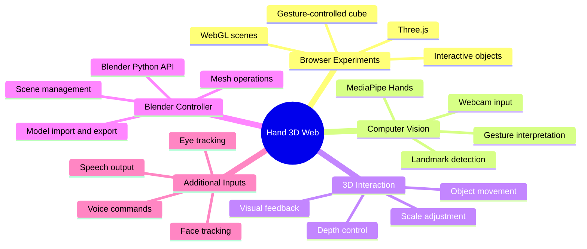
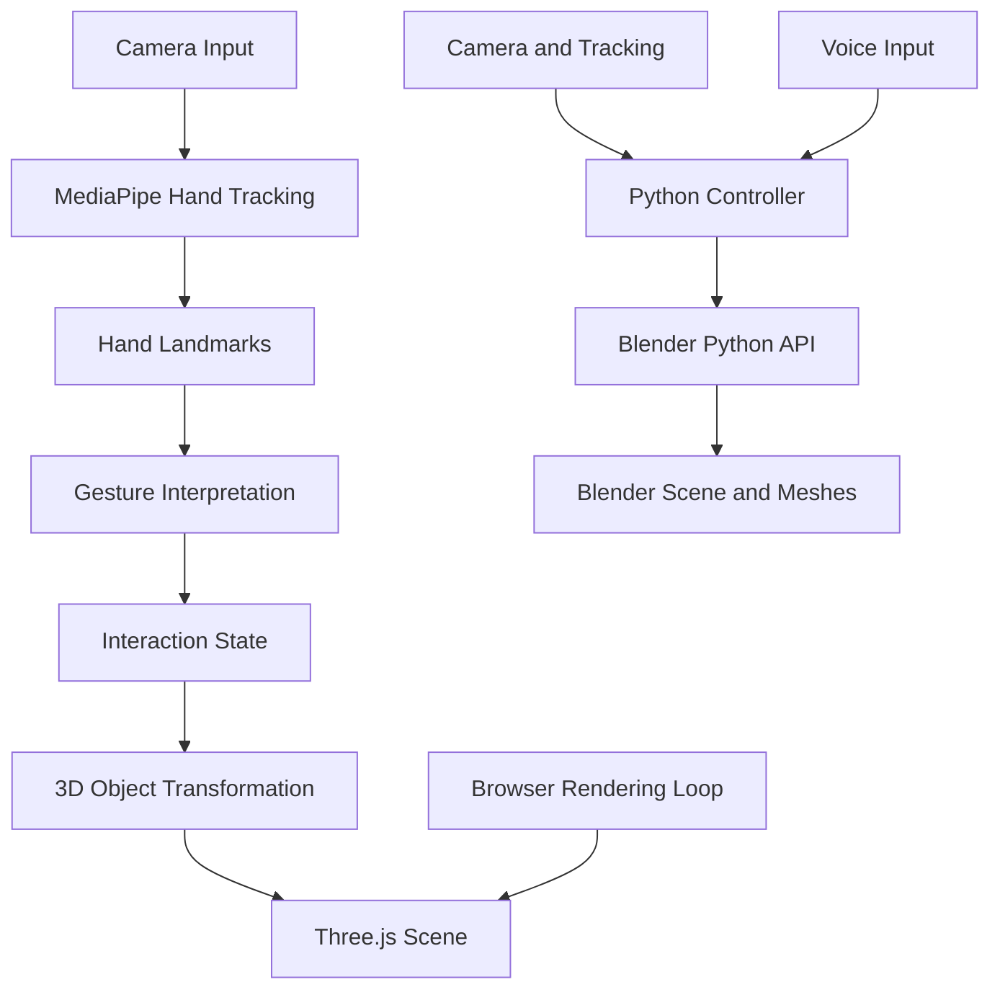
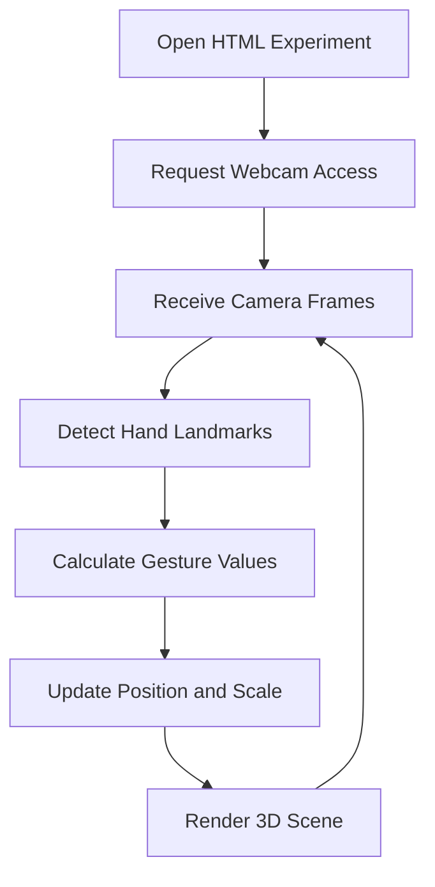

# Hand 3D Web ✋🌐
### Exploring 3D Interaction Through Computer Vision and Natural Gestures

Hand 3D Web is a collection of experimental 3D interaction projects exploring how computer vision, hand gestures, and interactive graphics can make digital objects easier to control.

The repository includes browser-based 3D experiments built with Three.js and MediaPipe, alongside a Blender-oriented Python controller that explores gesture-based modeling, voice commands, and 3D workflow automation.

<p align="center">
  
  
  
  
  
  
</p>

<p align="center">
  <a href="https://github.com/Harinath125/hand_3d_web">Source Code</a> •
  <a href="https://github.com/Harinath125/hand_3d_web/issues">Issues and Feedback</a>
</p>

---

## 🚀 Overview

Traditional 3D applications primarily rely on a mouse, keyboard, and other physical input devices. This project explores an alternative: using camera-based hand tracking to interact with digital objects in three-dimensional environments.

The repository brings together multiple experiments, including browser-based 3D scenes and a Python script designed to extend gesture-driven interaction into Blender.

### Key areas

- 🖐️ Camera-based hand landmark detection
- 🧊 Gesture-driven manipulation of browser-based 3D objects
- 📐 Depth movement and scale adjustment experiments
- 🎨 Interactive Three.js scenes and visual effects
- 🛠️ Blender modeling and scene-control automation
- 🎙️ Exploration of voice-command-based workflows
- 👁️ Face and eye-tracking capabilities in the Blender-oriented script

The repository contains several standalone experiments, so individual features and setup requirements can differ between files.

## 🧠 Project Mind Map



## 🏗️ System Architecture

The browser experiment and Blender controller are separate execution paths.



The browser path processes hand landmarks and applies transformations to a Three.js scene. The Blender path operates through Blender's Python API and has additional dependencies. This diagram is a conceptual overview, not a claim that the repository currently runs both paths as one connected application.

## 🖐️ Browser-Based Gesture Interaction

One of the browser experiments in `index1.html` combines MediaPipe Hands with Three.js to control a 3D cube.

### Demonstrated interaction design

| Input | Intended interaction |
|---|---|
| Pinch thumb and index finger | Grab and move the object |
| Move the hand forward or backward | Adjust depth along the Z-axis |
| Change the pinch distance | Adjust object scale |
| Move the hand in view | Control object position |

The HTML experiment also includes hand-landmark visualization and a particle-trail effect.

### Browser interaction workflow



## 🛠️ Technology Stack

| Technology | Role |
|---|---|
| Python | Computer-vision and Blender automation logic |
| OpenCV | Camera access and image processing |
| MediaPipe | Hand, face, and pose landmark detection |
| Three.js | Browser-based 3D scene rendering |
| WebGL | Hardware-accelerated graphics in the browser |
| HTML, CSS, JavaScript | Browser experiments and interaction interfaces |
| Blender Python API (`bpy`) | Modeling and scene manipulation |
| NumPy | Numerical operations |
| Anthropic SDK | Optional AI integration in the Blender-oriented script |
| Speech and text-to-speech libraries | Additional voice interaction capabilities |

Dependency availability and feature activation depend on the selected experiment and its configuration.

## 📂 Repository Structure

```text
hand_3d_web/
├── car.html                 # Car-related 3D experiment
├── env.html                 # Environment / 3D experiment
├── env3.html                # Additional scene experiment
├── env4.html                # Additional scene experiment
├── env5.html                # Additional scene experiment
├── env7.html                # Additional scene experiment
├── env10.html               # Additional scene experiment
├── hari.html                # Standalone HTML experiment
├── index1.html              # Gesture-controlled 3D cube experiment
├── index2.html              # Additional browser experiment
├── plane.html               # Plane-related 3D experiment
├── opencv-3d_modeling.py    # Blender-oriented Python controller
└── README.md
```

The filenames identify separate experiments. Inspect each HTML file to determine its specific scene and controls.

## ⚙️ Getting Started: Browser Experiments

### Prerequisites

- A modern browser with WebGL support
- A working webcam
- Internet access to load the CDN-hosted JavaScript libraries used by the HTML experiment
- Webcam permission granted to the browser

### 1. Clone the repository

```bash
git clone https://github.com/Harinath125/hand_3d_web.git
cd hand_3d_web
```

### 2. Start a local web server

Using Python:

```bash
python3 -m http.server 8000
```

### 3. Open the experiment

Open this URL in your browser:

```text
http://localhost:8000/index1.html
```

You can also open other HTML experiments by replacing `index1.html` with the relevant filename.

### 4. Allow camera access

If the page requests webcam permission, allow it. Place your hand within the camera's field of view and try the displayed gesture controls.

**Important:** Camera access normally requires a secure context such as `localhost` or HTTPS. Opening an HTML file directly with a `file://` URL may prevent camera access or cause asset-loading issues.

## 🧊 Blender Controller

The file `opencv-3d_modeling.py` is a separate Python script that imports Blender's `bpy` and `bmesh` APIs. It is not an ordinary standalone Python script that can be expected to run in a regular terminal interpreter.

The code explores a broader 3D modeling workflow, including:

- Hand-based object movement, scaling, and rotation
- Blender scene and object management
- Mesh analysis and quality checks
- Mesh cleanup, smoothing, and polygon reduction
- Material and lighting changes
- Import and export of supported 3D formats
- Screenshot and save-related operations
- Voice-command processing and speech output
- Face and eye-tracking experiments

Actual availability depends on Blender version, installed dependencies, camera access, configuration, and the state of the script.

### Blender setup considerations

1. Install a compatible version of Blender.
2. Open Blender's scripting workspace.
3. Review the script's configuration section before running it.
4. Install third-party packages into the Python environment used by Blender, not automatically into an unrelated system Python environment.
5. Verify the configured model and screenshot directories exist.
6. Test camera and optional integrations independently before using the complete workflow.

### Important configuration note

The script contains machine-specific filesystem paths, including paths for model files and screenshots. Update these to match your own system.

It also contains a placeholder Anthropic API key. If you enable AI integration, use an environment variable or another secure secrets mechanism instead of placing a real API key in the source code. Never commit real credentials to GitHub.

## 🔍 Engineering Concepts Demonstrated

### 1. Landmark-based interaction

A hand-tracking model estimates key points on the hand. Application logic can use the positions and distances between these points to interpret gestures.

### 2. Coordinate mapping

Camera landmarks and 3D scene coordinates use different coordinate systems. Converting between them is important for mapping hand motion to object movement.

### 3. Smoothing and responsiveness

Smoothing can reduce jitter in hand movement, while overly aggressive smoothing can introduce lag. Balancing these effects is important for a responsive interaction experience.

### 4. Rendering and feedback

Three.js renders the browser scene, while Blender handles its own scene and rendering systems. Visual feedback helps users understand the effect of detected gestures.

## 🧰 Troubleshooting

### The webcam does not start

- Use `http://localhost:8000` or a secure HTTPS origin.
- Check browser camera permissions.
- Close applications that may already be using the webcam.
- Verify that the browser can access a camera.

### The 3D scene appears blank

- Check the browser developer console for errors.
- Verify that CDN-hosted libraries can load.
- Confirm WebGL is supported and enabled.
- Try another HTML experiment to determine whether the issue is file-specific.

### Gestures are not detected reliably

- Improve lighting.
- Keep your hand visible and within the camera frame.
- Avoid excessive motion blur.
- Check the browser console for MediaPipe errors.
- Test with one hand first where the experiment expects one hand.

### Blender reports missing modules

Blender uses its own Python environment. Confirm that each required third-party module is installed in the environment used by your Blender installation.

### Blender cannot find a model or save a screenshot

Review the configured model and output directories. Replace machine-specific paths with valid paths on your own computer.

## 🔐 Privacy and Security

- Browser experiments may request webcam access.
- Grant camera permissions only to pages you trust.
- Review the code and network requests before making privacy claims about camera processing.
- Keep API credentials outside public source files.
- Review third-party library versions and their sources before deployment.

## 🗺️ Future Improvements

- [ ] Consolidate the standalone experiments into a unified interface
- [ ] Add screenshots and a short demonstration video
- [ ] Document the controls for every HTML experiment
- [ ] Add configurable gesture sensitivity and smoothing
- [ ] Improve error handling and camera initialization
- [ ] Add reproducible Blender dependency setup instructions
- [ ] Replace machine-specific paths with configurable settings
- [ ] Add automated tests for gesture interpretation and transformation logic
- [ ] Add a clear license and contribution guidelines

These are proposed improvements rather than claims about existing functionality.

## 👨‍💻 Author

**Rayala Harinath**

GitHub: [@Harinath125](https://github.com/Harinath125)

---

<p align="center">
  <b>Hand 3D Web</b><br/>
  Exploring a more natural way to interact with digital 3D environments.
</p>
